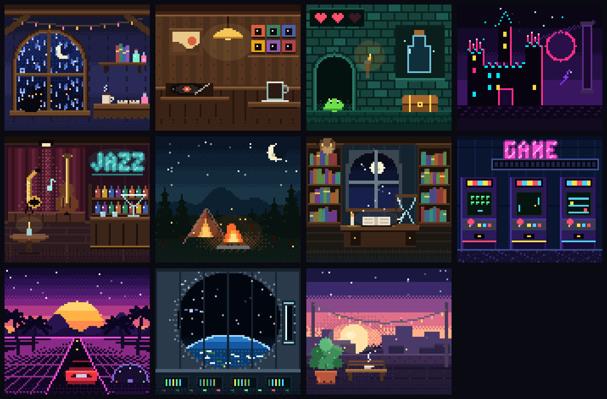
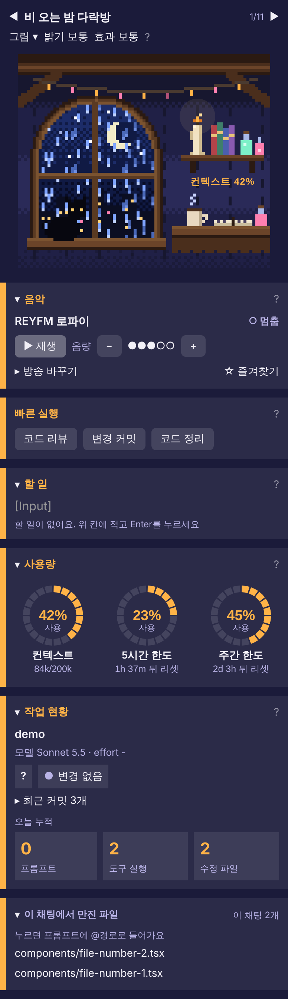

# pixel-tavern

Claude Code 데스크톱 앱용 모드입니다. 프롬프트 위에 픽셀 배너를 그리고, 오른쪽에 "여관" 패널을 엽니다. 배너와 패널에는 컨텍스트·5시간·주간 한도, 프로젝트·git 상태, 오늘 작업 통계, 할 일, 음악(Windows)이 모여 있어, 작업 화면을 떠나지 않고 지금 상태를 한눈에 봅니다. 장면은 아늑한 곳 6개와 모험 장소 5개, 모두 11개이고 장면마다 게이지가 다른 물건으로 그려집니다.





## 주요 기능

- **배너**: 컨텍스트·5시간·주간 한도 게이지, 프로젝트·브랜치·모델·effort, 재생 중인 곡 제목
- **패널 구역**(위에서 아래로)
  - 장면 그림: 밝기·효과 조절과 접기
  - 음악
  - 빠른 실행: 코드 리뷰·변경 커밋·코드 정리. 커밋과 정리는 두 번 눌러야 실행
  - 할 일: 모든 채팅이 같은 목록을 씀
  - 사용량: 원 3개
  - 작업 현황: git 상태·바뀐 파일·오늘 누적·연속 기록·오늘 작업 기록
  - 이 채팅에서 만진 파일
- **장면 11개**: 아늑 6개 · 모험 5개. "이런 장면을 그려 줘"라고 말하면 Claude가 [절차](docs/adding-a-scene.md)대로 그림·등록·시험·문서를 한 번에 더합니다.
- **음악(Windows 전용)**: 인터넷 라디오 16곳. 장면마다 방송을 따로 고르고 즐겨찾기를 저장합니다.
- **알림과 반응**: 작업이 끝나거나 테스트가 끝나면 배너 한마디가 바뀌고 그림이 반짝입니다. 한도가 90%를 넘으면 한 번 알립니다.
- **터미널 Claude Code**에서도 같은 배너와 패널이 나옵니다. 그림은 색 블록 정지 그림이고, 사용량은 글자 막대로 나옵니다.
- **기록은 최소로**: 파일 이름·프롬프트 글·명령 글·곡 제목은 저장하지 않습니다. 통계와 작업 기록에는 시각과 숫자만 남습니다.

구역마다 어떻게 동작하는지는 [docs/features.md](docs/features.md)에 모두 적어 두었습니다.

> 위 그림은 실제 앱 캡처가 아니라 `tools/render_panel.py`가 시험 도구의 화면 트리를 앱에서 잰 값(`tools/measured.json`)으로 그린 근사입니다(시험용 가짜 데이터).

<br clear="right">

## 쓰는 법

1. 이 폴더의 절대경로를 환경변수 `CLAUDE_CODE_PLUGIN_DIRS`에 넣고 앱을 다시 시작합니다.
2. `/tavern`으로 패널을 엽니다.

## 구조

`hooks/`의 TypeScript 모듈이 앱 이벤트(세션 시작, 프롬프트 제출, 도구 호출, 턴 시작·끝, 그리기)에 연결됩니다. 상태는 세션 상태와 세션 너머 저장소에 나눠 두고, git·라디오 재생기 같은 바깥 세계는 프로세스 실행으로 만납니다. 장면 그림은 `tools/scenes`의 원본에서 `tools/gen_art.py`가 SVG와 터미널용 칸 그림으로 생성합니다. 파일별 역할은 [docs/architecture.md](docs/architecture.md)에 있습니다.

## 개발

```
claude plugin validate .
claude plugin test .         # tests/ 의 시험 전부
npm install                      # 처음 한 번: 타입 검사용 TypeScript 5.9.3(정확한 버전 고정)을 설치한다
npm run typecheck                # 타입 검사(오류 0개가 정상, 약 10초). 시험·validate가 못 보는 타입 오류를 잡는다
python tools/gen_art.py      # 그림 원본(tools/scenes) -> hooks/art
python tools/render_panel.py # 패널을 앱 없이 근사해서 HTML로 그린다(tools/preview/tree-check.html)
python tools/render_term.py  # 터미널 화면(배너·패널)을 글자 칸 격자로 근사해서 HTML로 그린다(tools/preview/term-check.html)
```

`.claude-plugin/types/`는 엔진이 만드는 파일이라 저장소에 넣지 않았습니다.

### 시험 구성

시험은 `tests/`에 분류별로 있습니다: `function`(기능), `data`(데이터 정확성), `state`(상태 전환), `layout`(레이아웃), `usability`(사용성). 시험 제목 앞의 `[기능]` 같은 태그도 같은 분류입니다. 가짜 엔진과 공용 도우미는 `tests/kit.tsx`에 있습니다. 시험 계획은 [docs/test-plan.md](docs/test-plan.md), 보안 점검은 [docs/security-review.md](docs/security-review.md)에 있습니다.

### 실제 앱에서 크기 재기

화면 설계는 실제 폭·간격·글자 크기를 모르면 추정이 됩니다. 앱에서 `/tavern-diag`를 입력하면 패널 맨 위에 측정판이 나옵니다(열·줄 수, px 기준자, 칸 기준자, 간격 단계, 글자 크기, 버튼 표본). 캡처해서 값을 읽고 `tools/measured.json`에 적으면 `render_panel.py`가 그 값으로 그립니다. 다시 `/tavern-diag`를 입력하면 꺼집니다.

측정해 둔 값(데스크톱 앱, `tools/measured.json`): 패널 본문 폭 약 388px(열 51, 글자 칸 하나 약 7.7px), 글자 caption/footnote/body/heading/title = 12/13/14/15/22px, 간격 xs/sm/md/lg/xl = 6/8/12/16/24px, 버튼 높이 약 29px. 그림(SVG)은 선언한 px 그대로 그려지고 패널 안에서 줄어들지 않습니다.

## 라이선스

라이선스는 아직 정하지 않았습니다.
